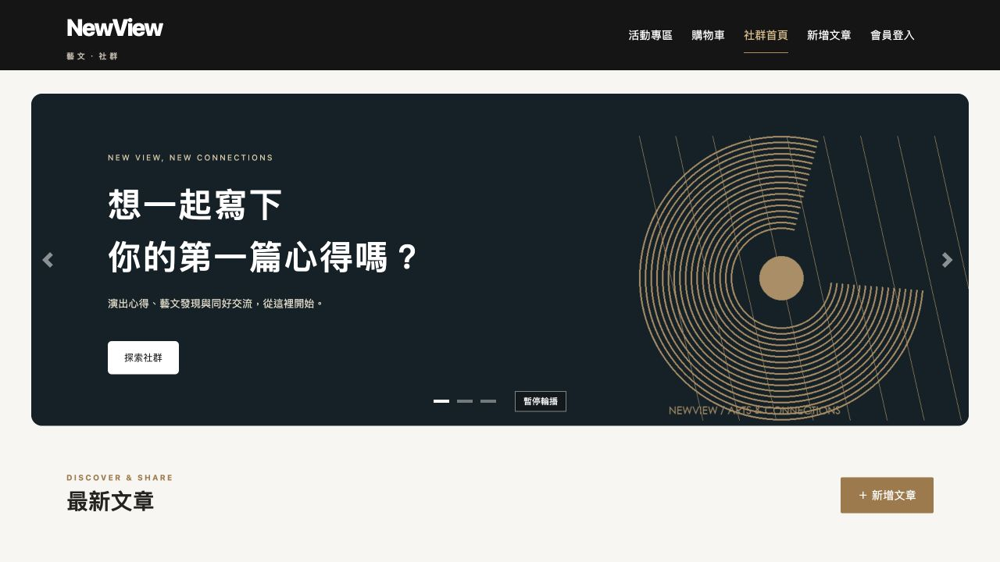
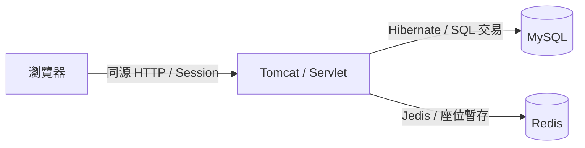

# NewView｜藝文售票與社群網站

此 Java 專案約於 2022–2023 年開發。整合會員、社群文章、活動收藏、選位與購物車，讓使用者由活動探索一路操作至訂單與票券查詢。

目前提供本機展示版本，使用虛構人物、活動與場地；結帳及核銷為示範流程，不串接真實付款、退款或寄信。



## 主要功能

- **會員**：註冊、登入、個人資料、修改與忘記密碼。
- **社群**：圖文發表、分類、搜尋、排序、分頁、按讚與留言。
- **活動**：列表、詳情、收藏、小中大型座位配置。
- **購票**：Redis 十分鐘座位暫存、購物車、多活動／廠商拆單、優惠券。
- **訂單與票券**：訂單對照、取消與釋放座位、QR Code、本機核銷及評價。

## 技術架構

Java 17、Servlet、Apache Tomcat 9、Maven、Hibernate、MySQL 8、Redis、HTML／CSS／JavaScript 與 AJAX。使用 Servlet WAR 部署至外部 Tomcat，Maven 明確管理必要相依套件。



## 目錄

| 位置 | 用途 |
|---|---|
| `app/` | Java 網站程式、Maven 設定與前端素材 |
| `database/` | 建表與功能增量 SQL，不含私人資料庫備份 |
| `scripts/` | 本機啟停與資料庫／展示資料初始化工具 |
| `tests/` | 功能、權限、交易與 QR 圖片測試 |
| `docs/` | 工程文件、架構圖、資料字典與展示圖片 |

## 第一次啟動

適用已準備 Java 17、Maven 3.9、Python 3、Docker（已啟動）與 Tomcat 9 的 macOS／Linux。Windows 原生腳本尚未驗證。

先在終端機進入專案根目錄（能看到README.md、app與scripts），將下方Tomcat路徑換成自己的安裝位置：

```sh
export CATALINA_HOME="/你的路徑/apache-tomcat-9"
python3 scripts/local.py build
python3 scripts/setup/setup_database.py
python3 scripts/setup/setup_redis.py
python3 scripts/local.py start
```

接著，**僅在第一次新建、可拋棄的展示資料庫**執行以下兩行；第一行會備份並替換展示庫內容，不要在已有需保留資料的庫上重跑：

```sh
python3 scripts/setup/seed_portfolio.py --replace-local-showcase
python3 scripts/setup/seed_portfolio_orders.py
```

啟動後開啟：[NewView 本機網站](http://127.0.0.1:8083/newview/forum_home.html)。

建立展示資料後，可使用以下帳密登入：

| 展示帳號 | 展示密碼 |
|---|---|
| `yuchen` 或 `yian` | `NewView-local-2026!` |

之後啟動不需重新建庫或執行種子；啟動前確保Docker已運作、CATALINA_HOME已設定，執行 `python3 scripts/local.py start`。已啟動則不必重跑。第一次安裝、停止、換電腦、修改前端與故障排除見 [完整啟動文件](docs/setup-and-validation.md)。

## 分工與驗證

個人於此專案負責統籌進度，主要製作社群首頁與互動功能，並參與購物車、Redis 暫存設計及 SQL 設計覆核；其他功能由團隊分工。詳見 [貢獻說明](CONTRIBUTIONS.md)。

這份展示版包含後續的環境、資料庫、介面與測試整理，不等同當年原始檔案的逐位元保存。原 SQL 遺失後已重建；不將後來整理的成果推定為當年已完成，也不宣稱全站由個人獨立開發。

此獨立版本已實際建庫、啟動，並完成15組547項整合檢查與瀏覽器流程驗證。見 [驗證狀態](docs/setup-and-validation.md)。

## 工程文件

- [技術選型與用途](docs/technology-decisions.md)
- [系統與部署架構](docs/architecture.md)
- [核心功能流程](docs/workflows.md)
- [ERD、資料字典與介面](docs/data-and-interfaces.md)
- [執行與驗證](docs/setup-and-validation.md)
- [第三方素材與授權](docs/THIRD_PARTY_NOTICES.md)
- [公開狀態與檢查紀錄](docs/PUBLICATION_REVIEW.md)
- [相依套件檢查](docs/DEPENDENCY_REVIEW.md)

原始碼已公開於 [GitHub](https://github.com/zihling-project-ai/newview-ticketing-website)；網站仍為本機展示，下載後須依啟動文件自行建立環境。真實交易、後台營運、有限站票庫存、壓力測試及正式部署不在本機展示範圍；團隊與課程內容已由維護者確認可公開分享；維護者另確認未使用課程以外的模板或素材；第三方函式庫、字型授權與套件安全檢查範圍見公開檢查文件。

## 前端維護方式

直接修改 `app/src/main/webapp/` 的 HTML、CSS 與 JavaScript；這些檔案是唯一前端來源。共用樣式與互動維護在CSS／JS；頁首導覽等HTML變更須同步相關頁面。下載專案不會自動啟動服務，須先安裝工具並依文件初始化及啟動。
