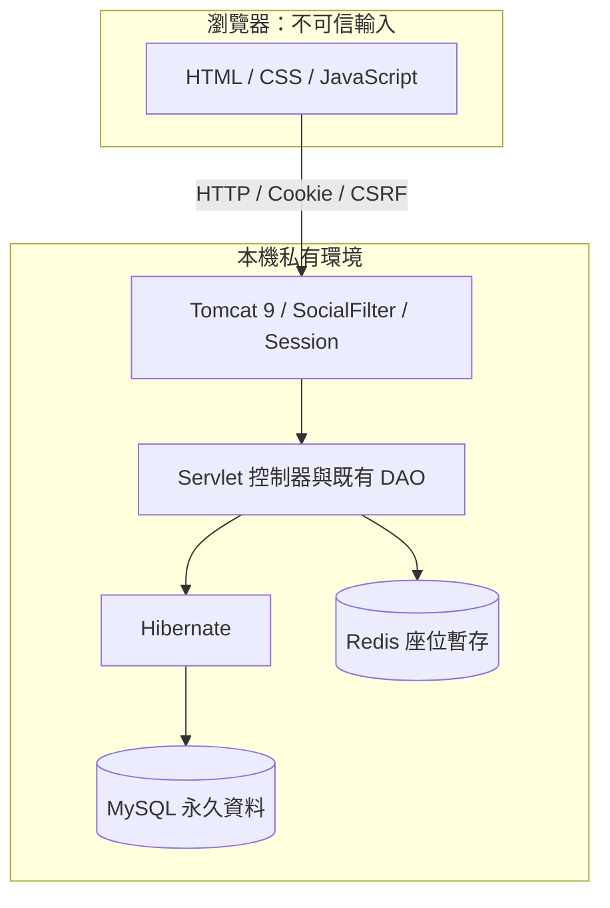

# 系統架構

## 後端元件

Java 路徑以 app/src/main/java/com/newview 為根目錄：

| 元件 | 路徑 | 責任 |
|---|---|---|
| 路由 | app/src/main/webapp/WEB-INF/web.xml | 明確 Servlet 映射、上傳限制與 Session 設定 |
| 過濾與登入狀態 | recovery/SocialFilter.java、MemberSessions.java | 路由邊界、社群權限／CSRF與密碼變更後 Session 失效 |
| 登入與會員 | user/controller/SignInController.java、recovery/MemberController.java、PasswordController.java | 密碼、會員資料、註冊／重設本機驗證 |
| 活動與收藏 | recovery/ActivityController.java、MemberLibraryController.java | 活動、收藏、本人訂單與票券對照 |
| 選位 | recovery/SeatController.java、SeatStore.java | 版位、SQL 已售資料與 Redis 暫鎖 |
| 購物車與優惠 | recovery/CartController.java、CouponStore.java | 試算、跨廠商拆單、交易與冪等收據 |
| 票券與取消 | recovery/TicketController.java、CancelOrderController.java、ReviewController.java | 擁有者／狀態檢查、核銷、釋位與評論 |
| 社群 | post/controller、post/model、postmessage | 圖文、互動、留言；保留 DAO／Service／VO 混合模式 |
| 連線設定 | util/HibernateUtil.java、app/src/main/resources/hibernate.cfg.xml | 環境變數、實體映射與結構驗證 |

不是每個控制器都通過同一 Service／Repository 層，部分直接使用原生 SQL；不宣稱是全面分層或微服務架構。前端不可信的會員編號、金額、QR 與座位都必須由伺服器重新檢查。

## 新副本的本機配置

| 服務 | 預設位置 |
|---|---|
| Tomcat 9 | 127.0.0.1:8083，網站路徑 /newview |
| MySQL | 127.0.0.1:3309，容器 newview-ticketing-mysql |
| Redis | 127.0.0.1:6383，容器 newview-ticketing-redis |
| 私人執行資料 | 專案旁的隱藏資料夾 .newview-ticketing-local；不在 GitHub 來源內 |

原本工作區與新副本的連接埠、容器名稱分開。Tomcat／Java 跑在本機，資料服務使用 Docker；本副本已完成本機建庫、啟動及完整整合回測；不代表正式或公開部署。停止功能依程序權限核對PID，本輪未另外測試停止以保留網站供使用者驗收。
