# 資料與介面

## 資料庫來源

database/01–14 為重建與增量 SQL；原 SQL 已遺失。下列結構已於2026-10-18由本副本新建展示庫的information_schema實際擷取，對應database SQL。共有27表，含為舊模型保留的後台實體，資料表存在不代表對外有後台功能。

## ERD

```mermaid
erDiagram
  Publisher {
    int pubID PK
  }
  act {
    int actID PK
    int actCategoryID
    int cityAddressID
    int pubID
  }
  actCategory {
    int actCategoryID PK
  }
  actpic {
    int actPicID PK
    int actID
  }
  administrator {
    int adminID PK
  }
  cartact {
    int cartActID PK
    int actID
    int userID
  }
  city {
    int cityAddressID PK
  }
  compic {
    int comPicID PK
    int orderListID
  }
  discount {
    int discountNO PK
    int adminID
    int pubID
  }
  likes {
    int likeID PK
    int postID
    int userID
  }
  local_cart_seat {
    int userID PK
    int actID PK
    varchar seatCode PK
  }
  local_checkout_receipt {
    varchar requestID PK
    int userID
  }
  local_coupon_redemption {
    int orderID PK
  }
  local_seat_booking {
    int actID PK
    varchar seatCode PK
    int orderListID
  }
  local_seat_layout {
    int actID PK
    varchar seatCode PK
  }
  local_simulation_order {
    int orderID PK
    varchar requestID
  }
  myLike {
    int myLikeID PK
    int actID
    int userID
  }
  orderlist {
    int orderListID PK
    int orderID
    int actID
  }
  orders {
    int orderID PK
    int userID
    int discountNO
    int pubID
  }
  post {
    int postID PK
    int postCategoryID
    int userID
  }
  postcategory {
    int postCategoryID PK
  }
  postmessage {
    int postMessageID PK
    int postID
    int userID
  }
  postpic {
    int postPicID PK
    int postID
  }
  pubUser {
    int pubUserID PK
    int pubID
  }
  report {
    int reportID PK
    int postID
    int userID
  }
  useDiscount {
    int useDisID PK
    int discountNO
    int userID
  }
  user {
    int userID PK
  }
  city |o--o{ act : "cityAddressID"
  Publisher |o--o{ act : "pubID"
  actCategory |o--o{ act : "actCategoryID"
  act |o--o{ actpic : "actID"
  user |o--o{ cartact : "userID"
  act |o--o{ cartact : "actID"
  orderlist |o--o{ compic : "orderListID"
  administrator |o--o{ discount : "adminID"
  Publisher |o--o{ discount : "pubID"
  post |o--o{ likes : "postID"
  user |o--o{ likes : "userID"
  user |o--o{ local_cart_seat : "userID"
  local_seat_layout |o--o{ local_cart_seat : "actID,seatCode"
  user |o--o{ local_checkout_receipt : "userID"
  local_seat_layout |o--o{ local_seat_booking : "actID,seatCode"
  orderlist |o--o{ local_seat_booking : "orderListID"
  act |o--o{ local_seat_layout : "actID"
  orders |o--o{ local_simulation_order : "orderID"
  local_checkout_receipt |o--o{ local_simulation_order : "requestID"
  act |o--o{ myLike : "actID"
  user |o--o{ myLike : "userID"
  act |o--o{ orderlist : "actID"
  orders |o--o{ orderlist : "orderID"
  Publisher |o--o{ orders : "pubID"
  user |o--o{ orders : "userID"
  discount |o--o{ orders : "discountNO"
  user |o--o{ post : "userID"
  postcategory |o--o{ post : "postCategoryID"
  post |o--o{ postmessage : "postID"
  user |o--o{ postmessage : "userID"
  post |o--o{ postpic : "postID"
  Publisher |o--o{ pubUser : "pubID"
  post |o--o{ report : "postID"
  user |o--o{ report : "userID"
  discount |o--o{ useDiscount : "discountNO"
  user |o--o{ useDiscount : "userID"
```

圖線表示實際宣告的外鍵；可空與必要性請以下列資料字典為準，不從圖形推定應用層限制。local_coupon_redemption 無宣告外鍵，訂單與優惠券關聯由程式交易維護。

## 資料字典

### Publisher

| 欄位 | SQL 型別 | 必填 | 索引標記 | 預設值 | 額外設定 |
|---|---|---|---|---|---|
| pubID | int | 是 | PRI | NULL | auto_increment |
| pubEmail | varchar(255) | 否 | — | NULL | — |
| pubName | varchar(255) | 否 | — | NULL | — |

### act

| 欄位 | SQL 型別 | 必填 | 索引標記 | 預設值 | 額外設定 |
|---|---|---|---|---|---|
| actID | int | 是 | PRI | NULL | auto_increment |
| actContent | text | 否 | — | NULL | — |
| actDate | date | 否 | — | NULL | — |
| actIntroduce | varchar(255) | 否 | — | NULL | — |
| actName | varchar(255) | 否 | — | NULL | — |
| actPrice | int | 否 | — | NULL | — |
| actScope | int | 否 | — | NULL | — |
| actTime | date | 否 | — | NULL | — |
| approvalCondition | tinyint | 否 | — | NULL | — |
| cityAddress | varchar(255) | 否 | — | NULL | — |
| time | time | 否 | — | NULL | — |
| actCategoryID | int | 否 | MUL | NULL | — |
| cityAddressID | int | 否 | MUL | NULL | — |
| pubID | int | 否 | MUL | NULL | — |

### actCategory

| 欄位 | SQL 型別 | 必填 | 索引標記 | 預設值 | 額外設定 |
|---|---|---|---|---|---|
| actCategoryID | int | 是 | PRI | NULL | auto_increment |
| actCategoryName | varchar(255) | 否 | — | NULL | — |

### actpic

| 欄位 | SQL 型別 | 必填 | 索引標記 | 預設值 | 額外設定 |
|---|---|---|---|---|---|
| actPicID | int | 是 | PRI | NULL | auto_increment |
| actPic | longblob | 否 | — | NULL | — |
| actID | int | 否 | MUL | NULL | — |

### administrator

| 欄位 | SQL 型別 | 必填 | 索引標記 | 預設值 | 額外設定 |
|---|---|---|---|---|---|
| adminID | int | 是 | PRI | NULL | auto_increment |
| adminAccount | varchar(255) | 否 | — | NULL | — |
| adminEmail | varchar(255) | 否 | — | NULL | — |
| adminName | varchar(255) | 否 | — | NULL | — |
| adminPassword | varchar(255) | 否 | — | NULL | — |

### cartact

| 欄位 | SQL 型別 | 必填 | 索引標記 | 預設值 | 額外設定 |
|---|---|---|---|---|---|
| cartActID | int | 是 | PRI | NULL | auto_increment |
| cartQuantity | int | 否 | — | NULL | — |
| actID | int | 否 | MUL | NULL | — |
| userID | int | 否 | MUL | NULL | — |

### city

| 欄位 | SQL 型別 | 必填 | 索引標記 | 預設值 | 額外設定 |
|---|---|---|---|---|---|
| cityAddressID | int | 是 | PRI | NULL | auto_increment |
| cityName | varchar(255) | 否 | — | NULL | — |

### compic

| 欄位 | SQL 型別 | 必填 | 索引標記 | 預設值 | 額外設定 |
|---|---|---|---|---|---|
| comPicID | int | 是 | PRI | NULL | auto_increment |
| comPic | longblob | 否 | — | NULL | — |
| orderListID | int | 否 | MUL | NULL | — |

### discount

| 欄位 | SQL 型別 | 必填 | 索引標記 | 預設值 | 額外設定 |
|---|---|---|---|---|---|
| discountNO | int | 是 | PRI | NULL | auto_increment |
| disAmount | int | 否 | — | NULL | — |
| disFinishDate | datetime(6) | 否 | — | NULL | — |
| disStartDate | datetime(6) | 否 | — | NULL | — |
| discountCode | varchar(255) | 否 | — | NULL | — |
| discountContent | varchar(255) | 否 | — | NULL | — |
| adminID | int | 否 | MUL | NULL | — |
| pubID | int | 否 | MUL | NULL | — |

### likes

| 欄位 | SQL 型別 | 必填 | 索引標記 | 預設值 | 額外設定 |
|---|---|---|---|---|---|
| likeID | int | 是 | PRI | NULL | auto_increment |
| likeOrNot | tinyint | 否 | — | NULL | — |
| visitorID | int | 否 | — | NULL | — |
| postID | int | 否 | MUL | NULL | — |
| userID | int | 否 | MUL | NULL | — |

### local_cart_seat

| 欄位 | SQL 型別 | 必填 | 索引標記 | 預設值 | 額外設定 |
|---|---|---|---|---|---|
| userID | int | 是 | PRI | NULL | — |
| actID | int | 是 | PRI | NULL | — |
| seatCode | varchar(16) | 是 | PRI | NULL | — |
| holdToken | varchar(36) | 是 | — | NULL | — |

### local_checkout_receipt

| 欄位 | SQL 型別 | 必填 | 索引標記 | 預設值 | 額外設定 |
|---|---|---|---|---|---|
| requestID | varchar(36) | 是 | PRI | NULL | — |
| userID | int | 是 | MUL | NULL | — |
| orderIDs | text | 是 | — | NULL | — |
| createdAt | datetime(6) | 是 | — | CURRENT_TIMESTAMP(6) | DEFAULT_GENERATED |

### local_coupon_redemption

| 欄位 | SQL 型別 | 必填 | 索引標記 | 預設值 | 額外設定 |
|---|---|---|---|---|---|
| orderID | int | 是 | PRI | NULL | — |
| useDisID | int | 是 | UNI | NULL | — |

### local_seat_booking

| 欄位 | SQL 型別 | 必填 | 索引標記 | 預設值 | 額外設定 |
|---|---|---|---|---|---|
| actID | int | 是 | PRI | NULL | — |
| seatCode | varchar(16) | 是 | PRI | NULL | — |
| orderListID | int | 是 | UNI | NULL | — |
| holdToken | varchar(36) | 否 | — | NULL | — |

### local_seat_layout

| 欄位 | SQL 型別 | 必填 | 索引標記 | 預設值 | 額外設定 |
|---|---|---|---|---|---|
| actID | int | 是 | PRI | NULL | — |
| seatCode | varchar(16) | 是 | PRI | NULL | — |

### local_simulation_order

| 欄位 | SQL 型別 | 必填 | 索引標記 | 預設值 | 額外設定 |
|---|---|---|---|---|---|
| orderID | int | 是 | PRI | NULL | — |
| requestID | varchar(36) | 是 | MUL | NULL | — |
| cancelledAt | datetime(6) | 否 | — | NULL | — |

### myLike

| 欄位 | SQL 型別 | 必填 | 索引標記 | 預設值 | 額外設定 |
|---|---|---|---|---|---|
| myLikeID | int | 是 | PRI | NULL | auto_increment |
| actID | int | 否 | MUL | NULL | — |
| userID | int | 否 | MUL | NULL | — |

### orderlist

| 欄位 | SQL 型別 | 必填 | 索引標記 | 預設值 | 額外設定 |
|---|---|---|---|---|---|
| orderListID | int | 是 | PRI | NULL | auto_increment |
| OrderListTime | datetime(6) | 否 | — | NULL | — |
| QRcodeID | longblob | 否 | — | NULL | — |
| actTotal | int | 否 | — | NULL | — |
| fiveStarReview | tinyint | 否 | — | NULL | — |
| reviewContent | varchar(255) | 否 | — | NULL | — |
| seatRowsColumns | varchar(32) | 否 | — | NULL | — |
| usedType | tinyint | 否 | — | NULL | — |
| orderID | int | 否 | MUL | NULL | — |
| actID | int | 否 | MUL | NULL | — |
| localTicketToken | varchar(43) | 否 | UNI | NULL | — |
| localRedeemedAt | datetime(6) | 否 | — | NULL | — |
| localReviewedAt | datetime(6) | 否 | — | NULL | — |

### orders

| 欄位 | SQL 型別 | 必填 | 索引標記 | 預設值 | 額外設定 |
|---|---|---|---|---|---|
| orderID | int | 是 | PRI | NULL | auto_increment |
| actQuantity | int | 否 | — | NULL | — |
| discount | int | 否 | — | NULL | — |
| discountPrice | int | 否 | — | NULL | — |
| ordTime | datetime(6) | 否 | — | NULL | — |
| ordTotal | int | 否 | — | NULL | — |
| ordType | tinyint | 否 | — | NULL | — |
| userID | int | 否 | MUL | NULL | — |
| discountNO | int | 否 | MUL | NULL | — |
| pubID | int | 否 | MUL | NULL | — |

### post

| 欄位 | SQL 型別 | 必填 | 索引標記 | 預設值 | 額外設定 |
|---|---|---|---|---|---|
| postID | int | 是 | PRI | NULL | auto_increment |
| disLikeCount | int | 是 | — | 0 | — |
| lastEditedTime | datetime(6) | 是 | — | CURRENT_TIMESTAMP(6) | DEFAULT_GENERATED |
| likeCount | int | 是 | — | 0 | — |
| postContent | text | 是 | — | NULL | — |
| postDateTime | datetime(6) | 是 | MUL | CURRENT_TIMESTAMP(6) | DEFAULT_GENERATED |
| postHeader | varchar(255) | 否 | — | NULL | — |
| postStatus | tinyint | 否 | — | NULL | — |
| postCategoryID | int | 否 | MUL | NULL | — |
| userID | int | 否 | MUL | NULL | — |

### postcategory

| 欄位 | SQL 型別 | 必填 | 索引標記 | 預設值 | 額外設定 |
|---|---|---|---|---|---|
| postCategoryID | int | 是 | PRI | NULL | auto_increment |
| postCategoryName | varchar(255) | 否 | — | NULL | — |

### postmessage

| 欄位 | SQL 型別 | 必填 | 索引標記 | 預設值 | 額外設定 |
|---|---|---|---|---|---|
| postMessageID | int | 是 | PRI | NULL | auto_increment |
| mesContent | text | 是 | — | NULL | — |
| messageDate | datetime(6) | 是 | — | CURRENT_TIMESTAMP(6) | DEFAULT_GENERATED |
| postID | int | 否 | MUL | NULL | — |
| userID | int | 否 | MUL | NULL | — |

### postpic

| 欄位 | SQL 型別 | 必填 | 索引標記 | 預設值 | 額外設定 |
|---|---|---|---|---|---|
| postPicID | int | 是 | PRI | NULL | auto_increment |
| postpic | longblob | 否 | — | NULL | — |
| postID | int | 否 | MUL | NULL | — |

### pubUser

| 欄位 | SQL 型別 | 必填 | 索引標記 | 預設值 | 額外設定 |
|---|---|---|---|---|---|
| pubUserID | int | 是 | PRI | NULL | auto_increment |
| pubAccount | varchar(255) | 否 | — | NULL | — |
| pubAuthority | tinyint | 否 | — | NULL | — |
| pubNickname | varchar(255) | 否 | — | NULL | — |
| pubPassword | varchar(255) | 否 | — | NULL | — |
| pubID | int | 否 | MUL | NULL | — |

### report

| 欄位 | SQL 型別 | 必填 | 索引標記 | 預設值 | 額外設定 |
|---|---|---|---|---|---|
| reportID | int | 是 | PRI | NULL | — |
| reportContent | varchar(255) | 否 | — | NULL | — |
| reportStatus | tinyint | 否 | — | NULL | — |
| postID | int | 否 | MUL | NULL | — |
| userID | int | 否 | MUL | NULL | — |

### useDiscount

| 欄位 | SQL 型別 | 必填 | 索引標記 | 預設值 | 額外設定 |
|---|---|---|---|---|---|
| useDisID | int | 是 | PRI | NULL | auto_increment |
| ditUsed | tinyint | 否 | — | NULL | — |
| discountNO | int | 否 | MUL | NULL | — |
| userID | int | 否 | MUL | NULL | — |

### user

| 欄位 | SQL 型別 | 必填 | 索引標記 | 預設值 | 額外設定 |
|---|---|---|---|---|---|
| userID | int | 是 | PRI | NULL | auto_increment |
| buyAuthority | tinyint | 否 | — | NULL | — |
| speakAuthority | tinyint | 否 | — | NULL | — |
| userAccount | varchar(255) | 否 | UNI | NULL | — |
| userBirth | date | 否 | — | NULL | — |
| userCell | varchar(255) | 否 | — | NULL | — |
| userEmail | varchar(255) | 否 | UNI | NULL | — |
| userName | varchar(255) | 否 | — | NULL | — |
| userNickname | varchar(255) | 否 | — | NULL | — |
| userPassword | varchar(255) | 否 | — | NULL | — |

## 索引與唯一限制

| 資料表 | 索引 | 唯一 | 欄位順序 |
|---|---|---|---|
| Publisher | PRIMARY | 是 | pubID |
| act | FK5je0en2o0hcr4juunujfjficp | 否 | cityAddressID |
| act | FK860fpy4wf21keyqrhq1t6kgxf | 否 | pubID |
| act | FKhd1ui1qgnsvw0ekyshjxifo6q | 否 | actCategoryID |
| act | PRIMARY | 是 | actID |
| actCategory | PRIMARY | 是 | actCategoryID |
| actpic | FKipmxr5mtrvsyq6mhf0fnyakg3 | 否 | actID |
| actpic | PRIMARY | 是 | actPicID |
| administrator | PRIMARY | 是 | adminID |
| cartact | FKhrc6w4md2nk0lv9pg0jygn8pb | 否 | actID |
| cartact | PRIMARY | 是 | cartActID |
| cartact | uq_member_cart | 是 | userID, actID |
| city | PRIMARY | 是 | cityAddressID |
| compic | FKa3jvt9bgcja9wuviiunjwv3ry | 否 | orderListID |
| compic | PRIMARY | 是 | comPicID |
| discount | FK1rk6ygw7jteba9ox1iouh4jio | 否 | adminID |
| discount | FKodu0aomuft6oprp5xgpaw6yil | 否 | pubID |
| discount | PRIMARY | 是 | discountNO |
| likes | FKra9vb9apsde261ops74ajf77 | 否 | userID |
| likes | PRIMARY | 是 | likeID |
| likes | uq_recovery_reaction | 是 | postID, userID |
| local_cart_seat | actID | 否 | actID, seatCode |
| local_cart_seat | PRIMARY | 是 | userID, actID, seatCode |
| local_checkout_receipt | fk_local_receipt_user | 否 | userID |
| local_checkout_receipt | PRIMARY | 是 | requestID |
| local_coupon_redemption | PRIMARY | 是 | orderID |
| local_coupon_redemption | useDisID | 是 | useDisID |
| local_seat_booking | orderListID | 是 | orderListID |
| local_seat_booking | PRIMARY | 是 | actID, seatCode |
| local_seat_layout | PRIMARY | 是 | actID, seatCode |
| local_simulation_order | fk_local_sim_receipt | 否 | requestID |
| local_simulation_order | PRIMARY | 是 | orderID |
| myLike | FK2qd6aj4ackrfdt23usrlmt7po | 否 | actID |
| myLike | PRIMARY | 是 | myLikeID |
| myLike | uq_member_favorite | 是 | userID, actID |
| orderlist | FKcb6jyy6ksbbra7uc79ej2b62o | 否 | actID |
| orderlist | FKjwvax8tqyc4i4k9vw30f21uq3 | 否 | orderID |
| orderlist | PRIMARY | 是 | orderListID |
| orderlist | uq_local_ticket_token | 是 | localTicketToken |
| orders | FK5i3hun091l0ojallfddl0el91 | 否 | pubID |
| orders | FKi5xgym2hb1nukjn11h0pvkhhq | 否 | userID |
| orders | FKrc2juxnyw4b6mqfmfcchppm78 | 否 | discountNO |
| orders | PRIMARY | 是 | orderID |
| post | FK48v93obu7hsmy5vph8b3h0ht | 否 | userID |
| post | FK4cy3nu2i8g9ukhsqe63f9w94x | 否 | postCategoryID |
| post | ix_recovery_feed | 否 | postDateTime, postID |
| post | PRIMARY | 是 | postID |
| postcategory | PRIMARY | 是 | postCategoryID |
| postmessage | FKgf3ttp6ot2rgq03eetlw7yiij | 否 | userID |
| postmessage | ix_recovery_comments | 否 | postID, messageDate |
| postmessage | PRIMARY | 是 | postMessageID |
| postpic | FKmw2ugabfsxr9ccsgemdkx4sau | 否 | postID |
| postpic | PRIMARY | 是 | postPicID |
| pubUser | FK72nb3lwyiqp5fcr7xpgm2xr28 | 否 | pubID |
| pubUser | PRIMARY | 是 | pubUserID |
| report | FKbaawii2loowo106o9i2jf9p2p | 否 | postID |
| report | FKol60oputga7t1uiwurhbj0mwd | 否 | userID |
| report | PRIMARY | 是 | reportID |
| useDiscount | FK8ivdstpvy7uf8og5jkos1dxde | 否 | discountNO |
| useDiscount | FKj3sbplqopjcka2jxobf7va561 | 否 | userID |
| useDiscount | PRIMARY | 是 | useDisID |
| user | PRIMARY | 是 | userID |
| user | uq_recovery_account | 是 | userAccount |
| user | uq_recovery_email | 是 | userEmail |

## 重要欄位與一致性

- orderlist 每筆代表一張票；seatRowsColumns 為座位字串，非選位票可空。
- 訂單 ordType：1 全票已使用、2 取消、3 本機待使用／部分使用。票券 usedType：0 未使用、1 已使用；未知狀態保守拒絕。
- local_seat_booking 主鍵 actID＋seatCode、唯一 orderListID，保護已成立的座位關聯。
- local_checkout_receipt 的 requestID 為唯一收據編號，查詢同時檢查本人；不是任意公開查詢網址。
- localTicketToken 是不透明隨機碼；localRedeemedAt／localReviewedAt 記錄本機核銷與評價。
- 帳號、信箱、互動、收藏與購物車有對應唯一鍵；優惠券使用由交易與唯一使用關聯維護。
- Redis 到期後 SQL 購物車可能仍留暫選資料，必須重新檢查並選位。MySQL／Redis 非分散式交易，站票無有限容量帳本，不宣稱全面防超賣。

## HTTP 介面

路徑前綴 /newview；主要為表單 Servlet，並非版本化 REST API。一般輸入為 URL-encoded，圖文與 QR 圖片使用 multipart。JSON 為主要回應，但圖片是 PNG，容器錯誤可能是 HTML。會員身分由 Session 決定，不能靠輸入 userID 取得他人資料。

| 介面 | 方法與主要輸入 | 回應／權限 |
|---|---|---|
| RecoverySession | GET；POST 登出 | 取得 CSRF／本人登入狀態；登出重建匿名狀態 |
| SignIn | POST account/password | 成功後更換 Session／csrf；錯誤401 |
| SignUp | POST 註冊欄位；action=verify、code | 本機驗證碼，驗證後新增；需匿名 Session＋CSRF |
| GetUserInfo／UpdateUserInfo | GET／POST 個資欄位 | 僅本人；修改需CSRF |
| UpdateUserPassword | POST oldPassword/newPassword/confirmNewPassword | 本人、CSRF、本機限制 |
| RetrievePassword／VerifyPassword | POST account/email；verificationCode/newPassword/confirmNewPassword | Session挑戰、CSRF；本機示範不寄信 |
| ActivityList／ActivityDetail／ActivityImage | GET；actID／picID | 公開活動資料／圖片 |
| MemberFavorites／likeChange | GET查詢；POST action=add/remove、actID | 本人收藏；寫入需CSRF |
| MemberOrders／MemberPage／MemberActivities | GET；訂單詳情提供orderID | 本人訂單／收藏／活動資訊 |
| MemberActivityImage | GET actID | 登入後圖片 |
| Seats | GET actID；POST action=hold/release、seats | 版位與暫鎖；修改需本人及CSRF |
| Cart | GET actIDs/useDisID；POST action、actID、quantity | 本人試算與購物車變動；選位商品須從Seats調整 |
| LocalCheckout | GET requestID；POST requestID/actIDs/useDisID/confirmSimulation | 本人收據、模擬拆單；POST需CSRF與本機限制 |
| CancelLocalOrder | POST orderID/confirmCancellation | 本人未使用訂單；CSRF；重複取消不重複釋位 |
| MemberCoupons | GET | 本人優惠券與可用狀態 |
| Tickets／TicketQR | GET ticketID，Tickets可省略以查列表 | 本人票券／PNG；失效票不顯示有效QR |
| PreviewTicket／DecodeTicketQR | POST payload／multipart image | 本人預覽，CSRF，不會核銷 |
| RedeemLocalTicket | POST payload/confirmSimulation | 本人明確核銷、CSRF；重複或取消票409 |
| ActivityReviews／TicketReview | GET actID／ticketID；POST ticketID/rating/content | 公開評論／本人評價；新增需已核銷票及CSRF |
| GetPostServlet／GetPostDetailServlet／GetPostCategoryServlet | GET／相容POST；action、postID | 公開文章與分類 |
| DoPostServlet／DeletePostServlet | POST 文章欄位／postID；圖片multipart | 登入、CSRF，修改刪除檢查作者 |
| DoLikeDislikeServlet | POST postID/action=like或dislike | 本人互動，CSRF |
| DoMessageServlet | GET action=GetAll；POST AddMsg／Update／Delete | 公開讀取；修改刪除檢查作者與CSRF |

完整38個映射位於 docs/evidence/servlet-routes.json，依改名後的 web.xml 重新產生。狀態碼依實作：400輸入、401未登入、403權限／CSRF、404不存在或隱藏他人資料、405方法、409狀態衝突、413圖片大小、429驗證碼冷卻、503 Redis異常；不宣稱每個錯誤回應有統一格式。
