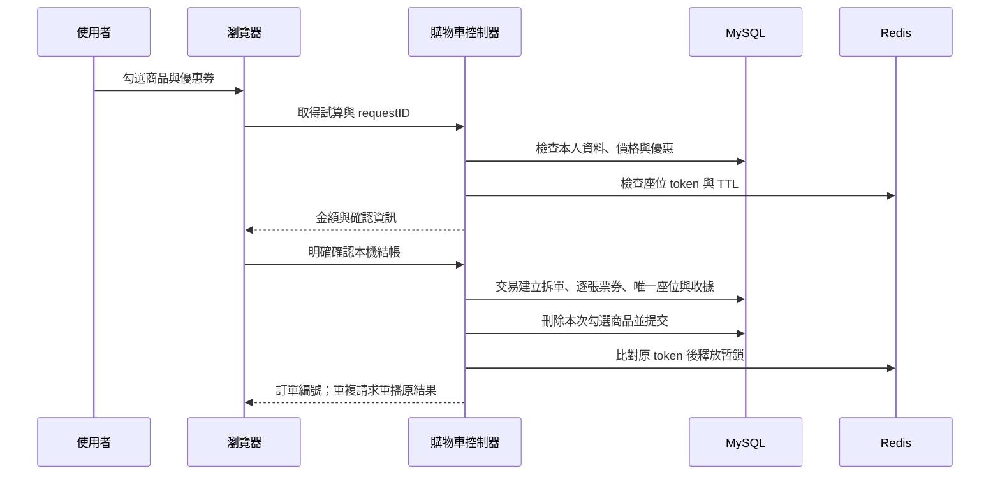
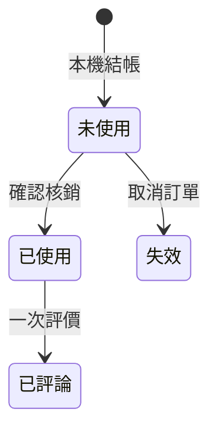

# 功能與核心流程

## 功能範圍

會員管理、社群圖文與互動、活動與收藏、選位暫存、購物車與優惠券、模擬訂單、票券核銷及評價。系統後台與廠商後台不在展示範圍。

## 登入

觸發：POST SignIn，提供 account/password。伺服器查帳號並驗證 PBKDF2；成功後更換 Session 與 CSRF，錯誤帳密回 401，輸入錯誤回 400。登入不載入整份訂單關聯。來源：user/controller/SignInController.java、recovery/Passwords.java。

## 選位

前提：登入、有效 CSRF、活動未結束、1–10 個有效且不重複的座位，購物車總量最多 50。鎖定會員與活動，檢查已售座位，再由 Redis Lua 嘗試暫鎖；成功後儲存 SQL 暫選與購物車。Redis 無法使用回 503，已被選走回 409。SQL 失敗時嘗試補償還原原 Redis 鎖。來源：SeatController.java、SeatStore.java。

## 結帳

試算綁定 Session、選取範圍、價格／數量與優惠，最長十分鐘；狀態改變必須重新確認。相同 requestID 查本人收據並重播，不再新增訂單。未勾選商品保留。錯誤寫入會回滾 SQL 交易，沒有真實支付。來源：CartController.java、CouponStore.java。

## 取消、核銷與評論

取消先檢查本人、模擬狀態與所有票券未使用，再依該訂單票券刪除座位關聯、設為已取消、還原優惠券；重複取消不重複釋放。已使用票不能整單取消。來源：CancelOrderController.java。

QR 只含不透明 token；預覽與圖片辨識不核銷，必須經本人登入及明確 POST 確認。取消或已使用票拒絕再次核銷。票券已核銷且未取消才能新增一次評論。來源：TicketController.java、ReviewController.java。

